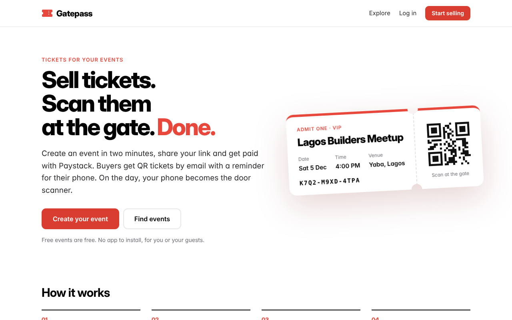
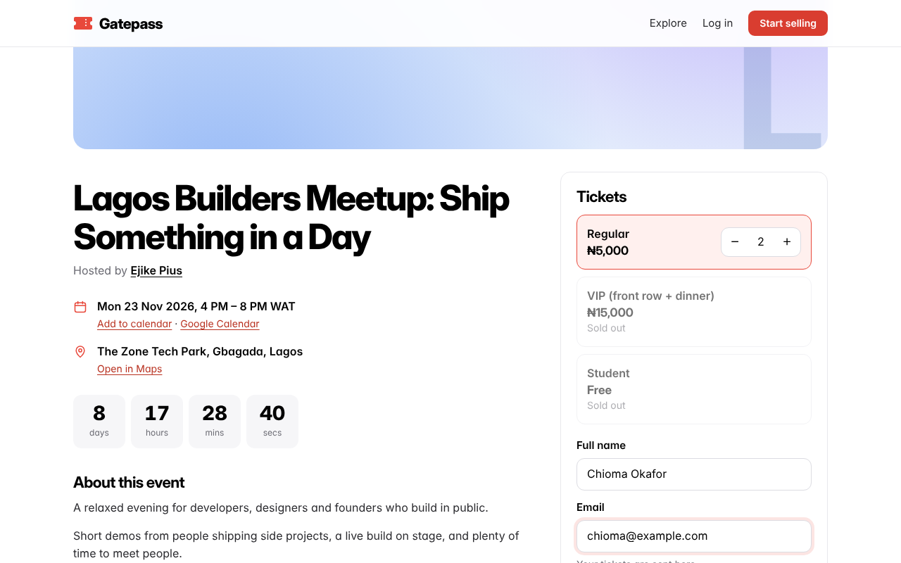
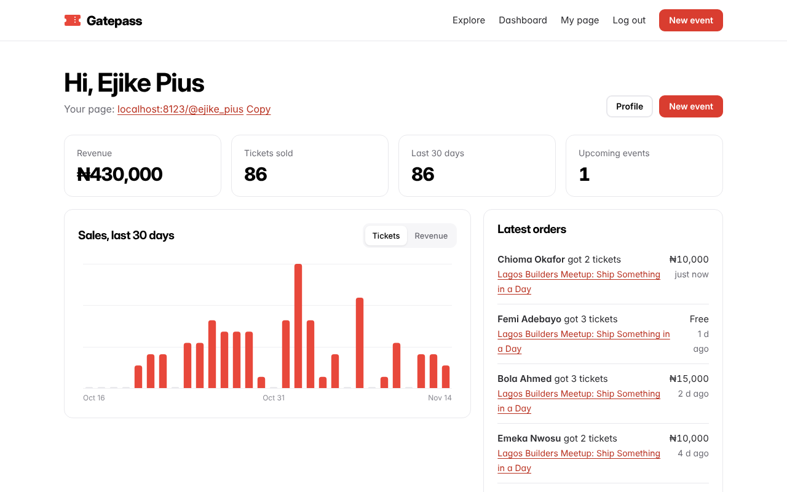
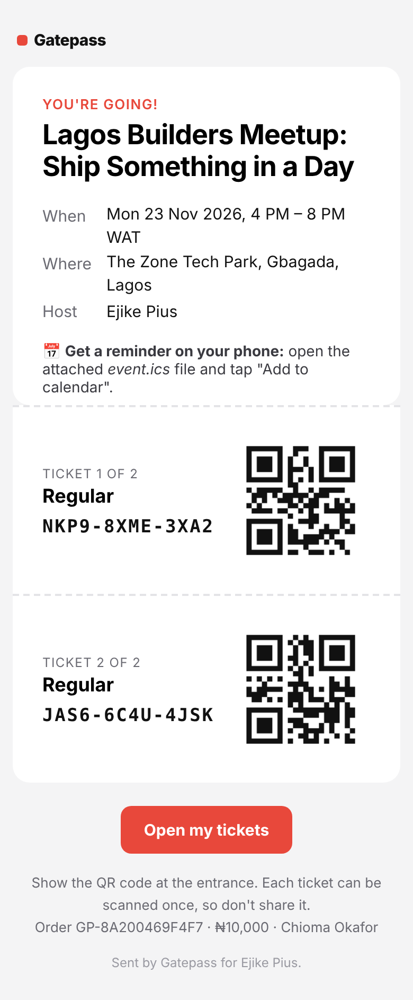

# Gatepass

**Sell tickets. Scan them at the gate. Done.**

Anyone can sign up, create events and sell tickets. Buyers get their tickets by email: one QR code per ticket and a calendar file that adds the event to their phone with reminders. On the day, the organizer's phone becomes the door scanner.

Day 4 of **The Daily Ship**, where I build one product a day. Live at **[gatepass.ejikepius.dev](https://gatepass.ejikepius.dev)**.



## Features

**For organizers**
- Your own page at `/@yourname` listing all your events
- Events with a cover photo, venue and/or online link, timezone, and up to 6 ticket types (Regular, VIP, Free...)
- Dashboard: revenue, tickets sold, a 30-day sales chart, latest orders
- Per-event page: share link + printable QR poster, sales by ticket type, searchable/sortable guest list, CSV export
- **Door scanner**: phone camera scans the QR, green for "Welcome in", amber for "Already used", red for fakes or the wrong event. Sound and vibration so staff don't need to read the screen
- Draft, publish, unpublish, cancel (buyers are emailed) or delete

**For buyers**
- No account needed: pick tickets, enter name and email, pay
- Ticket email with a QR code per ticket and an `event.ics` file (reminders the day before and an hour before)
- Another reminder email about 24 hours before the event
- A private ticket page (secret link) with Add to Calendar, Google Calendar and Print

**Explore** shows upcoming events from every organizer, with live search and filters.



## JavaScript (no framework, no build step)

All in [`public_html/assets/app.js`](public_html/assets/app.js) and [`scanner.js`](public_html/assets/scanner.js):

- **QR scanner**: `getUserMedia` camera, the browser's `BarcodeDetector` where it exists (Android), otherwise loads `jsQR` (iPhone). Scans a cropped, scaled-down frame ~8 times a second, ignores repeat reads, keeps the screen awake (Wake Lock API), plays a tone with the Web Audio API
- **Photo shrinking before upload**: drag-and-drop, resized on a `<canvas>` to ≤2000px JPEG, then put back into the real `<input type=file>` with `DataTransfer`, so a 10 MB phone photo uploads as ~300 KB
- **Sales chart** drawn by hand on `<canvas>`: sharp on retina screens, animated, hover tooltips, tickets/revenue toggle, redraws on resize (`ResizeObserver`)
- **Live search** on Explore: debounced `fetch`, cancels stale requests with `AbortController`, updates the URL, renders cards from a `<template>` with `textContent` (no HTML injection)
- **Ticket picker**: quantity steppers, per-order limit across ticket types, live total with `Intl` number formatting
- Countdown, sortable/searchable guest list, Web Share API, clipboard copy, animated counters, confetti



## How it works

```
Buyer picks tickets ──▶ Orders::reserve()     holds them for 15 min inside a write lock (no overselling)
                    ──▶ Paystack checkout     (or the demo checkout when no keys are set)
Paystack ──▶ /pay/callback and /paystack/webhook
                    ──▶ Paystack::verify()    server asks Paystack: paid? how much?
                    ──▶ Orders::markPaid()    amount must match; safe to run twice
                    ──▶ Notify::tickets()     email: QR per ticket (Qr.php) + event.ics (Ics.php)
cron (15 min) ──▶ bin/remind.php             releases unpaid holds, sends day-before reminders
Door ──▶ scanner.js ──▶ Orders::checkIn()     right event? already used? marks it, once
```

### Security notes

- **Payments**: a ticket only exists after the server verifies the payment with Paystack's API; the browser is never trusted. The amount must match the order total. Webhooks are checked with Paystack's HMAC-SHA512 signature, and verified again with the API
- **No overselling**: checkouts run in a SQLite `BEGIN IMMEDIATE` transaction; tickets in unpaid checkouts count as taken until they expire
- **Tickets**: 12-character codes from a 31-symbol alphabet (~59 bits), so they can't be guessed. Buyer pages use a separate 128-bit secret link. Check-in only accepts tickets for that event, once
- **QR codes are generated on the server** ([`src/Qr.php`](src/Qr.php), written from the spec), so ticket codes are never sent to a third-party QR service
- **Uploads**: checked to really be images, then redrawn with GD (anything hidden in the file is dropped); the uploads folder can't run scripts
- **CSV export** escapes cells starting with `=`, `+`, `-`, `@` (spreadsheet formula injection)
- The usual: prepared statements, escaped output, CSRF tokens (also on `fetch` calls), `password_hash`, ownership checks on every organizer action, rate limits on sign-up, log-in, checkout and scanning, security headers

## Run it locally

```bash
php bin/seed.php     # demo organizers, events and sales (log in as ejike_pius / password123)
GATEPASS_URL=http://localhost:8000 php -S localhost:8000 -t public_html public_html/index.php
php tests/run.php    # 37 tests
```

With no Paystack keys and the default `log` mail driver, payments use the demo checkout and emails are written to `data/mail.log`. The last one is saved as `data/last-email.html` so you can open it in a browser.



## Project structure

| Path | What it is |
|---|---|
| `public_html/index.php` | Router: every page, form and JSON endpoint |
| `public_html/assets/` | CSS, `app.js`, `scanner.js`, fonts, icons |
| `src/Events.php` | Events, ticket types, form validation, timezones |
| `src/Orders.php` | Checkout holds, payments, ticket codes, check-in, sales stats |
| `src/Paystack.php` | Start a payment, verify it, check webhook signatures |
| `src/Qr.php` | QR code generator (Reed–Solomon, masking), PNG and SVG |
| `src/Ics.php` | Calendar files with reminders |
| `src/Notify.php` | Ticket, reminder and cancellation emails |
| `src/Mailer.php` | Small SMTP mailer with inline images and attachments, no packages |
| `src/Covers.php` | Cover image checks and resizing |
| `bin/remind.php` | Cron job |
| `views/` | Page templates; `views/emails/` holds the emails |
| `tests/run.php` | Tests |


## Credits

Built by **Ejike Pius** ([@ejike_pius](https://x.com/ejike_pius), [ejikepius.dev](https://ejikepius.dev)). MIT licence.
